<div align="center">

  

  # 🎓 Awesome Enterprise Learning Management System (LMS)

  <p align="center">
    <strong>A curated directory of top-tier Enterprise Learning Management Systems (LMS), Corporate Training Suites, Academic E-Learning Platforms, and Sovereign Open-Source Education Infrastructure.</strong>
  </p>

  <p align="center">
    <a href="https://github.com/ishandutta2007/Awesome-Awesome-Awesome"></a><a href="https://discord.gg/jc4xtF58Ve"></a>
    <a href="https://github.com/ishandutta2007/Awesome-Enterprise-Learning-Management-System-LMS/stargazers"></a>
    <a href="https://github.com/ishandutta2007/Awesome-Enterprise-Learning-Management-System-LMS/network/members"></a>
    <a href="https://github.com/ishandutta2007/Awesome-Enterprise-Learning-Management-System-LMS/blob/main/LICENSE"></a>
    <a href="https://github.com/ishandutta2007/Awesome-Enterprise-Learning-Management-System-LMS/pulls"></a>
    <a href="https://github.com/ishandutta2007"></a>
  </p>

</div>

---

## 📖 Overview & Ecosystem Landscape

Modern organizations require robust digital learning infrastructure to deliver, manage, and track employee upskilling, regulatory compliance certifications, partner enablement, and higher education curricula. **Enterprise Learning Management Systems (LMS)** unify course authoring, automated cohort enrollments, assessment engines, and learning analytics while adhering to interoperability standards such as **SCORM (1.2 / 2004)**, **xAPI (Experience API / Tin Can)**, **cmi5**, and **LTI (Learning Tools Interoperability 1.3 Advantage)**.

Whether deploying a scalable SaaS platform for workforce governance or self-hosting a sovereign, open-source LMS for academic autonomy, this directory categorizes the premier tools powering corporate enterprises, government agencies, and universities worldwide.

---

## 📑 Table of Contents

- [🌐 Sector Overview & Market Dynamics](#-sector-overview--market-dynamics)
- [☁️ SaaS & Hosted Enterprise LMS Platforms](#️-saas--hosted-enterprise-lms-platforms)
- [🔓 Open-Source GitHub Projects (Ranked by Stars)](#-open-source-github-projects-ranked-by-stars)
- [📊 Architectural Comparison Matrix](#-architectural-comparison-matrix)
- [🔍 Key Evaluation Criteria for Enterprise LMS](#-key-evaluation-criteria-for-enterprise-lms)
- [🤝 How to Contribute](#-how-to-contribute)
- [📈 Star History](#-star-history)
- [💖 Support & Sponsorship](#-support--sponsorship)
- [⚖️ Disclaimer](#️-disclaimer)

---

## 🌐 Sector Overview & Market Dynamics

The global **Enterprise Learning Management System (LMS) market** was valued at approximately **$25.4 Billion in 2024** and is projected to surpass **$68.5 Billion by 2030**, exhibiting a rapid Compound Annual Growth Rate (**CAGR of ~18.2%**). This expansion is accelerated by mandatory corporate compliance training, remote workforce onboarding, skills-gap remediation, and the integration of Generative AI for automated course authoring and personalized learning paths.

The sector demonstrates **moderate fragmentation with diversified specialization** rather than a winner-take-all monopoly:
1. **Corporate Human Capital & Talent Suites (Moderately Concentrated)**: Mega-vendors such as Cornerstone OnDemand, SAP Litmos, and Docebo hold significant corporate market share, deeply embedded within enterprise HRIS ecosystems (Workday, SAP SuccessFactors, ADP).
2. **Academic & Sovereign Open-Source (Highly Diversified)**: Instructure Canvas and Blackboard dominate North American higher education, while open-source flagships—such as **Moodle**, **Open edX**, and **Frappe LMS**—command hundreds of millions of sovereign learners globally across universities, European public institutions, and cost-conscious emerging enterprises.

---

## ☁️ SaaS & Hosted Enterprise LMS Platforms

| Platform | Market Valuation / ARR | Primary Focus & Key Capabilities | Pricing (Starting Tier) | Free Tier Limits & Trial Terms |
| :--- | :--- | :--- | :--- | :--- |
| **[Adobe Learning Manager](https://learningmanager.adobe.com/)** | **~$215B+ Market Cap** ($21.4B ARR; Parent Adobe NASDAQ: ADBE) | 🎨 Enterprise compliance, customer education, and personalized skills paths integrated with Adobe Creative Cloud. | **~$4.00 – $9.00/user/mo** (Registered User or Monthly Active User model, annual enterprise contract). | **30-day sandbox trial** with complete administrative controls and course delivery features upon sign-up. |
| **[Cornerstone OnDemand](https://www.cornerstoneondemand.com/)** | **$5.2B Valuation** (~$750M+ ARR; Acquired by Clearlake Capital) | 🏢 Global workforce talent management, skills intelligence, organizational hierarchy, and audit compliance. | **~$3.50 – $8.00/employee/mo** (LMS module entry tier; annual/multi-year commitment, min. 500 seats). | **Guided enterprise POC sandbox** (0-day instant self-serve; custom staging portal provisioned during sales evaluation). |
| **[Canvas LMS (Cloud SaaS)](https://www.instructure.com/canvas)** | **$4.8B Valuation** (~$530M+ ARR; Acquired by KKR) | 🎓 Cloud academic LMS for schools and higher education featuring SpeedGrader and comprehensive LTI integrations. | **~$5.00 – $30.00/student/year** (Institutional annual contract based on enrolled student FTE). | **Free-for-Teacher account** (free forever, capped at **500 MB course storage, 50 MB student storage, ~50 students/course**). |
| **[Blackboard Learn](https://www.blackboard.com/)** | **$3.0B Valuation** (~$500M+ ARR; Merged with Anthology) | 🏛️ Academic higher education, institutional course management, Grade Center, and virtual classroom collaboration. | **~$9,500/year** (Baseline institutional cohort tier; scales based on Full-Time Equivalent student headcount). | **30-day institutional trial sandbox** for verified university faculty and academic administrators. |
| **[Docebo](https://www.docebo.com/)** | **~$800M – $1.1B Market Cap** ($217M FY2024 Revenue; NASDAQ/TSX: DCBO) | 🤖 AI-driven enterprise LMS for employee upskilling, partner certification, and extended enterprise customer portals. | **~$25,000 – $35,900/year** (AWS Marketplace list price: $35,900/year for up to 500 Yearly Active Users). | **14-day guided proof-of-concept (POC)** sandbox configured by sales engineering (no self-serve free tier). |
| **[360Learning](https://360learning.com/)** | **~$800M Valuation** (~$50M+ ARR; $200M round led by SoftBank/Sumeru) | 🤝 Collaborative peer-to-peer learning, AI-assisted course creation, and collaborative workforce upskilling. | **$8.00/user/mo** (Team plan, billed monthly with no minimum contract). | **30-day free trial** with full feature access for up to **100 users** (no credit card required; no free tier). |
| **[Absorb LMS](https://www.absorblms.com/)** | **>$500M Valuation** (~$100M+ ARR; Acquired by WCAS) | 📊 Scalable corporate training, automated compliance workflows, eCommerce storefronts, and deep BI reporting. | **~$14,500/year** (Baseline contract for up to 500 active learners; averages ~$30–$60/learner/year). | **Sales-facilitated evaluation sandbox** (0-day instant self-serve; bespoke trial environment provisioned during review). |
| **[SAP Litmos](https://www.litmos.com/)** | **~$350M – $500M Valuation** (~$40M–$60M ARR; Acquired by Francisco Partners) | 📦 Rapid-deployment corporate LMS with built-in compliance content catalog, mobile learning, and SAP connectors. | **~$4.00 – $6.00/active user/mo** (Foundation tier; baseline contracts start at ~$8,000–$15,000/year). | **14-day free trial** with access for up to **20 test users**, course authoring, and reporting (no credit card needed). |
| **[LearnUpon](https://www.learnupon.com/)** | **~$250M Valuation** (~$42M ARR; Backed by Summit Partners) | 🌐 Multi-tenant portal management for unified employee training, customer education, and partner certification. | **~$10,000 – $15,000/year** (Employee plan with strict minimum threshold of **100 active users**; ~$8–$12/user/mo). | **Sales-assisted sandbox environment** for evaluating multi-portal architectures and SCORM/xAPI packages. |
| **[TalentLMS](https://www.talentlms.com/)** | **~$150M – $200M Valuation** (~$20M+ ARR; Epignosis) | 🚀 Intuitive corporate onboarding, employee upskilling, customer training, and rapid SCORM course authoring. | **$119/mo** (Core plan, billed annually at $99/mo; up to 40 active users). | **Free forever plan** capped at **5 users & 10 courses** with unlimited email support and testing tools. |
| **[iSpring Learn](https://www.ispringsolutions.com/ispring-learn)** | **~$100M Valuation** (~$28M–$50M ARR; iSpring Solutions) | ⚡ Fast workplace onboarding, microlearning, SCORM compliance, and PowerPoint-to-course conversion. | **$2.99/user/mo** (Start plan for up to 100 users, billed annually at $3,588/year). | **14-day free trial** with complete platform access for up to **50 learners** and 3 administrators. |

---

## 🔓 Open-Source GitHub Projects (Ranked by Stars)

A comprehensive directory of open-source Learning Management Systems, headless learning engines, lecture capture systems, and xAPI data infrastructure, sorted in descending order of GitHub community stars.

- **[BigBlueButton](https://github.com/bigbluebutton/bigbluebutton)** [](https://github.com/bigbluebutton/bigbluebutton/stargazers)  
  *Premier open-source virtual classroom and synchronous web conferencing platform designed specifically for online education.* Deeply integrates into Moodle, Canvas, and Sakai with real-time multi-user whiteboards, breakout rooms, synchronized polling, closed captioning, and presentation sharing.

- **[Open edX](https://github.com/openedx/openedx-platform)** [](https://github.com/openedx/openedx-platform/stargazers)  
  *Massive open online course (MOOC) platform originally engineered by MIT and Harvard.* Powers edX.org, national education initiatives, and large enterprise universities. Features scalable Django/Python architecture, XBlock modularity, studio authoring, auto-graded coding problem sets, and discussion forums.

- **[Moodle](https://github.com/moodle/moodle)** [](https://github.com/moodle/moodle/stargazers)  
  *The world's most widely deployed open-source learning management system.* Powers hundreds of thousands of institutions across 240+ countries. Backed by 2,000+ community plugins, complete SCORM 1.2/2004, LTI 1.3 Advantage compliance, customizable gradebooks, competency frameworks, and mobile app sync.

- **[Canvas LMS (Open-Source Core)](https://github.com/instructure/canvas-lms)** [](https://github.com/instructure/canvas-lms/stargazers)  
  *The self-hostable open-source Ruby on Rails core of Instructure Canvas.* Offers modern educator and student user interfaces, SpeedGrader assessment workflows, discussion boards, comprehensive REST APIs, and deep LTI standard tool support.

- **[Frappe LMS](https://github.com/frappe/lms)** [](https://github.com/frappe/lms/stargazers)  
  *Modern, 100% open-source learning management system built on Python, Frappe Framework, and Vue 3.* Delivers clean course authoring, video lessons, batch management, quizzes, student forums, certification generation, and seamless integration with ERPNext.

- **[Learnhouse](https://github.com/learnhouse/learnhouse)** [](https://github.com/learnhouse/learnhouse/stargazers)  
  *Next-generation open-source learning platform for creators, communities, and companies.* Features a sleek modern architecture, markdown/rich-text lesson editing, video streaming, interactive exercises, and self-hosted Docker deployments.

- **[ClassroomIO](https://github.com/classroomio/classroomio)** [](https://github.com/classroomio/classroomio/stargazers)  
  *Open-source customer education and developer training platform.* Helps SaaS businesses build interactive onboarding academies with code sandboxes, progress tracking, and custom domain branding.

- **[Courselit](https://github.com/codelitdev/courselit)** [](https://github.com/codelitdev/courselit/stargazers)  
  *Self-hosted open-source alternative to Teachable, Thinkific, and Podia.* Lets educators and organizations create and sell courses, digital downloads, and blogs with built-in payment gateway integrations (Stripe, PayPal).

- **[Sakai](https://github.com/sakaiproject/sakai)** [](https://github.com/sakaiproject/sakai/stargazers)  
  *Enterprise-grade academic learning collaboration suite built with Java.* Maintained by a global alliance of universities including Oxford, Duke, and Notre Dame. Excels in collaborative research, testing, grading rubrics, and high-concurrency campus deployments.

- **[Kolibri](https://github.com/learningequality/kolibri)** [](https://github.com/learningequality/kolibri/stargazers)  
  *Offline-first learning platform optimized for low-bandwidth and disconnected environments.* Designed for schools, refugee camps, and remote facilities with local peer-to-peer sync, curriculum alignment, and rich offline content libraries.

- **[Tutor (Open edX Distribution)](https://github.com/overhangio/tutor)** [](https://github.com/overhangio/tutor/stargazers)  
  *The official Docker-based Open edX distribution and deployment orchestrator.* Drastically simplifies installing, configuring, upgrading, and maintaining production-grade Open edX clusters on bare metal or Kubernetes.

- **[Chamilo LMS](https://github.com/chamilo/chamilo-lms)** [](https://github.com/chamilo/chamilo-lms/stargazers)  
  *High-efficiency PHP LMS dedicated to accessibility and ease of use.* Features structured learning path builders, virtual classroom integrations, skill tracking, certification management, and low server footprint.

- **[Pupilfirst](https://github.com/pupilfirst/pupilfirst)** [](https://github.com/pupilfirst/pupilfirst/stargazers)  
  *Ruby on Rails LMS engineered for asynchronous project-based schools.* Centers on action-driven tasks, video reviews, student peer reviews, automated grading workflows, and community engagement.

- **[Django LMS](https://github.com/adilmohak/django-lms)** [](https://github.com/adilmohak/django-lms/stargazers)  
  *Clean and extensible learning management system built with Python and Django.* Provides course registration, grade and assessment tracking, online quizzing, lecture scheduling, and faculty/student role dashboards.

- **[uLearn](https://github.com/safytech/ulearn)** [](https://github.com/safytech/ulearn/stargazers)  
  *Full-stack responsive LMS web application engineered in Laravel and React.* Supports on-demand video streaming courses, interactive lesson modules, multiple instructor profiles, and automated digital certificate generation.

- **[Gibbon](https://github.com/GibbonEdu/core)** [](https://github.com/GibbonEdu/core/stargazers)  
  *Flexible open-source school management system and LMS designed for educators.* Unifies student information records, attendance tracking, lesson planning, rubrics-based gradebooks, and homework submissions into a single self-hosted PHP core.

- **[Adapt Framework](https://github.com/adaptlearning/adapt_framework)** [](https://github.com/adaptlearning/adapt_framework/stargazers)  
  *Award-winning responsive HTML5 e-learning course authoring framework.* Produces deep SCORM 1.2/2004 and xAPI compliant single-page interactive learning experiences accessible across smartphones, tablets, and desktop browsers.

- **[Sensei LMS](https://github.com/Automattic/sensei)** [](https://github.com/Automattic/sensei/stargazers)  
  *Open-source WordPress LMS plugin developed by Automattic.* Seamlessly integrates with WooCommerce to monetize lessons, quiz builders, learner profiles, and interactive media directly inside WordPress websites.

- **[Opencast](https://github.com/opencast/opencast)** [](https://github.com/opencast/opencast/stargazers)  
  *Enterprise-grade open-source lecture capture and video management platform for universities.* Provides scheduled recording ingestion, automated processing, multi-stream playback, and tight integration with Moodle, Canvas, and Sakai.

- **[ILIAS](https://github.com/ILIAS-eLearning/ILIAS)** [](https://github.com/ILIAS-eLearning/ILIAS/stargazers)  
  *German-engineered, enterprise-grade learning management platform.* Widely used by military, government agencies, and medical universities for its granular role-based permissions, advanced testing/exam engine, and strict data privacy compliance.

- **[OpenOLAT](https://github.com/OpenOLAT/OpenOLAT)** [](https://github.com/OpenOLAT/OpenOLAT/stargazers)  
  *Swiss-engineered Java LMS for higher education and corporate continuous training.* Features visual course building, coaching tools, collaborative wikis, forums, and comprehensive assessment security.

- **[Claroline](https://github.com/claroline/Claroline)** [](https://github.com/claroline/Claroline/stargazers)  
  *Collaborative learning experience platform built with PHP and Symfony.* Focuses on customizable workspaces, resource sharing, modular pedagogical activities, and institution-wide learner analytics.

- **[Richie](https://github.com/openfun/richie)** [](https://github.com/openfun/richie/stargazers)  
  *Open-source education portal CMS created by France Université Numérique (FUN).* Aggregates courses, programs, and certifications from multiple LMS backends (Open edX, Moodle) into a unified, high-performance course catalog.

- **[Leemons](https://github.com/leemonade/leemons)** [](https://github.com/leemonade/leemons/stargazers)  
  *Modern open-source Learning Experience Platform (LXP) built completely in Node.js and JavaScript.* Provides micro-modular plugin architecture, customizable dashboard widgets, and tailored curriculum frameworks.

- **[LearnPress](https://github.com/LearnPress/learnpress)** [](https://github.com/LearnPress/learnpress/stargazers)  
  *Comprehensive WordPress LMS plugin.* Provides curriculum management, quiz creation, progress tracking, and payment processing for instructors and independent training companies.

- **[LifterLMS](https://github.com/gocodebox/lifterlms)** [](https://github.com/gocodebox/lifterlms/stargazers)  
  *Open-source WordPress LMS solution for online courses and training.* Offers lesson progression, achievement gamification badges, automated emails, and private coaching zones.

- **[Marsha](https://github.com/openfun/marsha)** [](https://github.com/openfun/marsha/stargazers)  
  *Open-source LTI-compliant Learning Content Management System (LCMS).* Specializes in live and on-demand video streaming, timed transcripts, interactive webinars, and classroom recording delivery via LTI 1.3.

- **[Ralph](https://github.com/openfun/ralph)** [](https://github.com/openfun/ralph/stargazers)  
  *High-performance Learning Record Store (LRS) and analytics ingestion engine.* Collects, validates, and stores standardized xAPI learning events with Elasticsearch and ClickHouse data pipelines.

- **[Forma LMS](https://github.com/formalms/formalms)** [](https://github.com/formalms/formalms/stargazers)  
  *Corporate-oriented open-source LMS fork of Docebo Core.* Tailored specifically for business training, skill gap analysis, organizational chart mapping, and automated certification workflows.

- **[Joanie](https://github.com/openfun/joanie)** [](https://github.com/openfun/joanie/stargazers)  
  *Headless education ERP for managing course orders, subscriptions, payment billing, and official diploma delivery.* Integrates with Richie and Open edX.

- **[Warren](https://github.com/openfun/warren)** [](https://github.com/openfun/warren/stargazers)  
  *Learning analytics visualization toolkit.* Reads xAPI telemetry from Ralph LRS to generate intuitive student engagement dashboards and course drop-off reports.

---

## 📊 Architectural Comparison Matrix

| Project | Primary Tech Stack | Database Engine | Interoperability Standards | Multitenancy | Deployment Model | Primary Sweet Spot |
| :--- | :--- | :--- | :--- | :--- | :--- | :--- |
| **BigBlueButton** | Java / Scala / Node.js | Redis + PostgreSQL | LTI 1.1 / 1.3, WebRTC | ⚠️ Server Partitioning | Ubuntu Bare Metal / VM | Synchronous live classrooms, breakout rooms & webinars |
| **Open edX** | Python / Django / React | MySQL + MongoDB | LTI 1.1 / 1.3, xAPI | ⚠️ Multi-Domain Plugin | Docker / Kubernetes (Tutor) | Global MOOCs & university-scale video academies |
| **Moodle** | PHP / JavaScript | MySQL / PostgreSQL / MariaDB | SCORM 1.2/2004, LTI 1.3, xAPI | ⚠️ Via Totara/IOMAD | Bare Metal, VMs, Docker | General-purpose academic & enterprise learning |
| **Canvas LMS** | Ruby on Rails / React | PostgreSQL | LTI 1.1 / 1.3 Advantage, QTI | ❌ Single Organization | Docker / AWS CloudFormation | Higher education institutions & K-12 school districts |
| **Frappe LMS** | Python / Vue.js 3 | MariaDB | REST APIs, Webhooks | ✅ Native Frappe Multitenancy | Bench / Docker Compose | Fast, modern corporate academies & developer portals |
| **Sakai** | Java / Spring Framework | MySQL / Oracle | LTI 1.3 Advantage, SCORM, IMS | ⚠️ Institutional Hierarchy | Apache Tomcat / Linux | Research universities & academic collaboration |
| **Chamilo** | PHP / Twig | MySQL / MariaDB | SCORM 1.2, xAPI, LTI | ⚠️ Multiple Campus Extension | LAMP / Docker | Resource-light institutions & public administration |
| **Gibbon** | PHP / MySQL | MySQL / MariaDB | Modular Hooks, CSV/REST | ❌ Single School Core | Apache / PHP 8+ | K-12 school administration & unified curriculum |
| **ILIAS** | PHP / JavaScript | MySQL / PostgreSQL | SCORM 1.2/2004, LTI 1.3, QTI | ✅ Client Partitioning | Apache / Linux Server | High-security corporate, defense & medical training |
| **Kolibri** | Python / Django | SQLite / PostgreSQL | Offline Content Packs | ❌ Local Appliance | Local Wi-Fi, Raspberry Pi, Android | Remote, offline & low-bandwidth rural schools |
| **Ralph & Warren** | Python / FastAPI / ES | Elasticsearch / ClickHouse | xAPI (Tin Can API), cmi5 | ✅ API-Key Scoped | Microservices / Docker | Learning Record Store & institutional analytics |

---

## 🔍 Key Evaluation Criteria for Enterprise LMS

When selecting an Enterprise Learning Management System, platform evaluators, procurement teams, and solution architects prioritize:

1. **Interoperability & Data Standards**:
   - **SCORM (1.2 / 2004 3rd & 4th Ed)**: Legacy packaging for e-learning content modules with status and score reporting.
   - **xAPI (Tin Can API)**: Modern activity streams capturing mobile learning, simulations, offline tasks, and software tool interactions.
   - **cmi5**: Modern successor reconciling SCORM governance rules with xAPI data payload flexibility.
   - **LTI (Learning Tools Interoperability 1.3 Advantage)**: Seamless plug-and-play integration of third-party tools, code sandboxes, and virtual classrooms (e.g. BigBlueButton, Zoom, Teams).
2. **Enterprise HRIS Integration**: Automated bidirectional employee sync with Workday, SAP SuccessFactors, ADP Workforce Now, and BambooHR via SCIM v2 and REST APIs.
3. **Multi-Tenant Architecture**: Partitioning branded portals for subsidiary business units, external channel partners, customer academies, and contractor cohorts.
4. **Automated Regulatory Compliance**: Expiration tracking, recurrent recertification workflows, audit trails, and electronic signature sign-offs (FDA 21 CFR Part 11, OSHA, HIPAA).

---

## 🤝 How to Contribute

Contributions, platform additions, and documentation enhancements are enthusiastically welcome!

1. 🍴 **Fork the repository** to your own GitHub account.
2. 🌿 **Create a descriptive feature branch**:
   ```bash
   git checkout -b feat/add-lms-platform
   ```
3. 📝 **Commit your modifications** ensuring objective, factual descriptions, standard link anchors, and Stars_Badges.
4. 🚀 **Push the branch** and **open a Pull Request** with a concise explanation of your changes.

---

## 📈 Star History

[](https://star-history.dera.page/#ishandutta2007/Awesome-Enterprise-Learning-Management-System-LMS&type=date&legend=top-left)

---

## 💖 Support & Sponsorship

Thank you for exploring and utilizing the **Awesome Enterprise Learning Management System** curated directory! Maintaining an up-to-date, comprehensive, and factual ecosystem guide takes substantial continuous effort and research.

If this directory brings value to your engineering team, educational institution, or enterprise vendor selection, please consider showing your support:

- ⭐ **Star this repository** to improve discoverability across GitHub.
- 🍴 **Fork the repository** to keep an active reference for your team.
- 📢 **Share with fellow educators**, HR technologists, and platform engineers.
- ☕ **Buy me a coffee / sponsor on GitHub** to fund continuous research and upkeep:

<p align="center">
  <a href="https://github.com/sponsors/ishandutta2007">
    
  </a>
</p>

---

## ⚖️ Disclaimer

- This repository is a **community-curated index** created solely for informational, architectural, and educational purposes. Mention of specific vendors, open-source projects, or commercial SaaS products does not constitute an official endorsement.
- **Data Compliance**: LMS platforms handling sensitive learner records must comply with applicable data protection regulations including **GDPR**, **FERPA**, and **SOC 2 Type II**.
- **Self-Hosting Governance**: Production self-hosted LMS clusters require independent security hardening, automated backup pipelines, database read-replica isolation, and regular vulnerability patching.

---

<p align="center">
  <strong>Crafted with ❤️ for learning technologists, platform engineers, instructional designers, and educational leaders worldwide.</strong>
</p>
